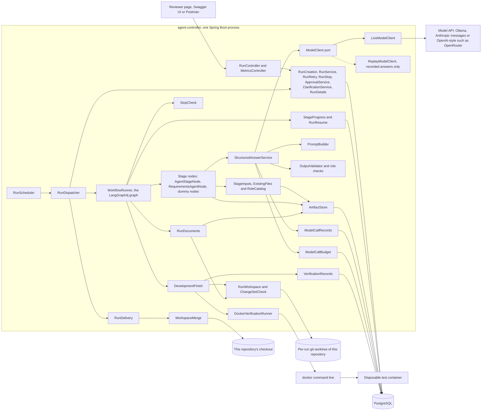
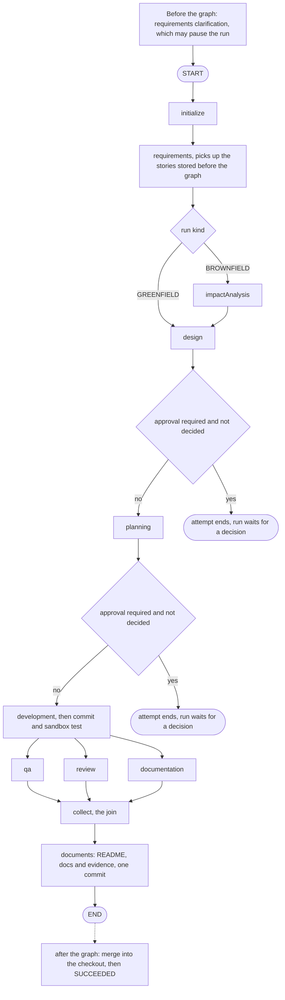
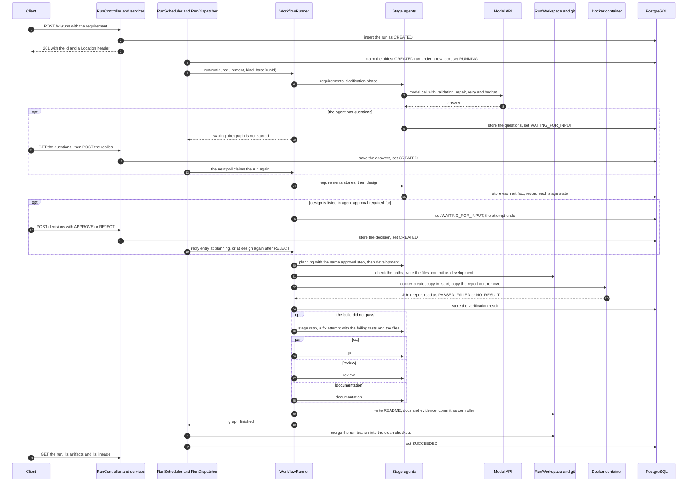
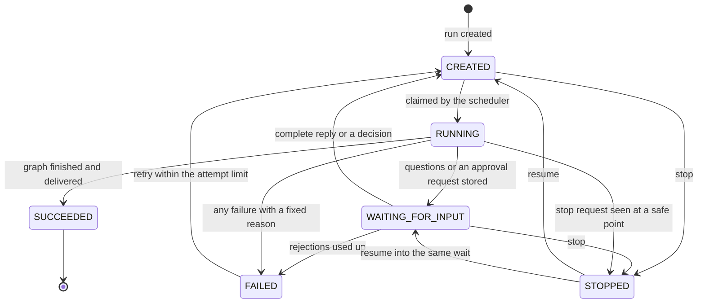

# Architecture overview

This describes the system as built on branch `feat/agent-pipeline` on 2026-10-05. One Spring Boot controller takes a written requirement through requirements, design, planning, development, QA, review and documentation. It runs under human approval of the design and the plan and under automatic checks, and it merges the verified result into this repository. The product it builds is a small URL shortener in Python. The platform code names no product ([AGENTS.md](../../AGENTS.md)).

The platform is a thin end-to-end pipeline with some governance on top of it ([ADR 0004](../adr/0004-build-a-thin-end-to-end-skeleton-first.md)). Section 8 lists what is not built. Read `SUCCEEDED` as "the stages returned, the generated tests passed in the sandbox, and the work was merged". It does not mean reviewed, fully tested against the criteria, or release-ready.

The requirements are in [agent-pipeline.md](requirements/agent-pipeline.md) (what was built) and [agent-pipeline-backlog.md](requirements/agent-pipeline-backlog.md) (what was not).

Sections: 1 Components, 2 Orchestration model, 3 Control flow of one run, 4 Data stored, 5 Guardrails, 6 Observability and traceability, 7 Key decisions, 8 Not built.

## 1. Components

One Spring Boot application holds the REST API, the scheduler, the graph, the agents, the model clients, the artifact store, the workspace, the sandbox runner and the merge into the checkout. Only PostgreSQL runs in Docker Compose. The controller runs on the host and starts the `git` and `docker` command lines as processes. The reviewer page is static HTML, CSS and JavaScript that the controller serves.

An agent is not a service. It is data plus one generic class. The data is a role file (`agent-roles/<role>.properties`) with the identity, the standards, the artifact kinds the role may read, the fields of its answer and its boundaries. The class is `AgentStageNode`, which builds the prompt, calls the model through `StructuredAnswerService`, and stores the validated answer as an artifact.



Packages, all under `io.github.bereket1144.agentcontroller`:

| Package | What it holds |
| --- | --- |
| `run` | The REST API (`RunController`, errors as `application/problem+json`), the run entity and its status, `RunService` (create, claim, succeed, fail, stop), `RunCreation` (kind and base-run checks), `RunScheduler` and `RunDispatcher`, `RunRetry`, `RunStop` and `StopCheck`, `ApprovalService`, `ClarificationService`, `RunDelivery`, `RunDetails` (stages, artifacts, verification and lineage reads), and the fixed failure reasons |
| `workflow` | `WorkflowRunner` (the graph, stage retry, resume entry, approval edges), the dummy nodes, `AgentStageNode` (one generic stage for any role), `AgentStages` (which roles run on an agent), `RequirementsAgentNode` (clarification, then stories), `DevelopmentFinish` (commit, build, fix attempts), `ExistingFiles`, `RunResume` and `StageProgress` |
| `agent` | `RoleCatalog`: the eight role definitions, and `InputAccessDeniedException` |
| `model` | The `ModelClient` port, `ModelProfile` and its settings, `PromptBuilder`, `OutputValidator` and the role checks, `StructuredAnswerService`, `ModelCallBudget`, and `LiveModelClient`, which sends a call to `OllamaModelClient`, `HostedModelClient` (Anthropic messages API) or `OpenAiCompatibleModelClient` by the profile's `api-style`. The clients use Spring's `RestClient`; no class uses Spring AI |
| `modelcall` | `ModelCallRecords` (one row per attempt), `InputFingerprint`, `Recording` and `ReplayModelClient` |
| `artifact` | `ArtifactStore` (immutable, versioned outputs), `ArtifactRef` and `StageInputs` (what a role may read) |
| `workspace` | `RunWorkspace` (worktree, branch, write, delete, commit), `ChangeSet` and `ChangeSetCheck` (path and size rules), `WorkspaceFiles` (bounded file reads), `WorkspaceMerge` (preflight and merge into the checkout), `GitCommands` |
| `sandbox` | The `VerificationRunner` port, `DockerVerificationRunner`, the `DockerCommand` port, `JunitReportParser`, the verification result and its records |
| `document` | `MarkdownRenderer` and `RunDocuments` (the README, `docs/` and the evidence files, written from artifacts) |
| `metrics` | `MetricsService` and `GET /v1/metrics` |
| `checkpoint` | `CheckpointSaverFactory` for the LangGraph4j PostgreSQL saver. Only tests use it; the running graph has no saver |
| `static/` resources | The reviewer page at `/` (start, questions, approvals, stages, artifacts, lineage, metrics, retry, stop and resume) |

Settings that choose behaviour:

| Setting | Effect |
| --- | --- |
| `agent.stages.<role>` | `dummy` (the default: a marker node, no model) or `agent`. `development=agent` also switches on the workspace, the commit-and-build step, the document export, the merge and the reading of existing files. `application-live.properties` sets every stage except `impactAnalysis` to `agent` |
| `agent.models.*` | The model profiles (model, address, window, answer limit, timeout, call slots, retries, key, `api-style`, `reasoning`), the primary profile, an optional fallback and a profile per role |
| `agent.model-client.mode` | `live` (the default) or `replay` with a recording file |
| `agent.budget.*`, `agent.output.repair-limit`, `agent.models.retry-delay` | Call and token limits, the repair limit (2) and the first retry wait (200 ms) |
| `agent.stage.max-retries` | How many more times a failed stage is attempted (2) |
| `agent.run.max-attempts` | How many attempts a run may have in all (3) |
| `agent.approval.required-for`, `agent.approval.max-rejections` | The stages a reviewer must approve (`design`, `planning`; empty by default, both in the live profile) and the rejections that end a run (3) |
| `workspace.*` | `base` (where worktrees live, outside the checkout), `repository` (this repository), `base-ref`, `product-folder` (`apps/url-shortener`) and `auto-merge` (false by default, true in the live profile) |
| `sandbox.verify.*` | The image, the test command, the report path, the container limits, and the two sentences that tell the agents the execution context and the file layout |
| `run.dispatch.*` | Whether the scheduler runs and the wait between polls (5 seconds) |

## 2. Orchestration model

### 2.1 One fixed graph

`WorkflowRunner` builds one LangGraph4j `StateGraph` when the controller starts and compiles it once. The topology does not change at run time. Each stage node is the role's agent when its setting says so, and its dummy node otherwise.



An agent stage reads only the artifacts its role may read, asks the role, stores one artifact and puts its `ArtifactRef` (kind, version, fingerprint) in graph state. The development node is wrapped by `DevelopmentFinish`. An open question in the answer of a stage other than requirements does not pause the run. It is added to the assumptions as "Unanswered question: ...".

Graph state holds the run id, the requirement text, the run kind, the base run id, the artifact references, and after development the commit id and the verification outcome. Stage outputs are in the artifact store, not in state.

A retry or a resume enters the graph at a later stage. A conditional edge from `START` reads a start point and goes to `impactAnalysis`, `design`, `planning`, `development`, or to a group node that starts QA, review and documentation together. The state of the earlier stages is rebuilt from the latest stored artifact of each (`RunResume`), so those stages are not run again.

### 2.2 Parallel stages and the join

QA, review and documentation are three edges out of development, so they run side by side. LangGraph4j overlaps them only when the run supplies an executor for the fan-out node. `WorkflowRunner` registers a virtual-thread-per-task executor for `development` and for the resume group (guarded by `ParallelBranchesJoinTest`). `collect` starts only when all three have finished. If one branch throws, the run fails, the other branches are interrupted with `shutdownNow`, and `collect` never runs. That helps only branches that honour interruption.

The three branches start from the same state, so none reads another's artifact in the same run. QA and review are handed the requirements, design, plan and the full development artifact. Documentation is handed the requirements, design, plan and an outline of the development artifact without file contents. A profile allows one concurrent model call by default, so in the live setting the three branches take turns at the model.

The graph has three fixed branches. A run-time number of parallel development tasks (the scheduler of [ADR 0001](../adr/0001-run-the-task-scheduler-inside-one-node.md)) is not built. Development runs once for all stories.

### 2.3 Human pauses

**Clarification (outside the graph).** Before the graph starts, `RequirementsAgentNode.prepare` settles clarification ([ADR 0007](../adr/0007-clarify-with-questions-and-answers-only.md)). The agent may return at most four questions. They are stored as requirements version 1 with a `clarification_batch` row, the run becomes `WAITING_FOR_INPUT`, and the graph is not started. A complete reply to `POST /v1/runs/{id}/replies` (one non-blank answer per question) stores the answers and queues the run again. The agent then writes the stories (version 2) and lists every choice nobody decided as an assumption. There is one batch and no time limit.

**Approvals (inside the graph).** `agent.approval.required-for` lists `design` and/or `planning`. When a listed stage has stored its artifact and the version has no decision, `ApprovalService.waitForDecision` sets `WAITING_FOR_INPUT` and the edge after the stage ends the attempt. No thread is held. What the run waits for is read from stored data (the latest artifact of a finished listed stage with no decision), so the wait survives a restart. `POST /v1/runs/{id}/decisions` takes `APPROVE` or `REJECT`, an approver name and a comment (required for `REJECT`). Approval queues the run at the next stage. Rejection sets the stage back, queues it again, and gives the agent every reviewer comment so far. After three rejections of one stage the run ends `FAILED` with the reason `REJECTED`. Every decision is a row in `approval_decision`, unique per artifact version.

### 2.4 Stage retry and fix attempts

`WorkflowRunner.attempts` wraps every stage. A failure with the reason `OUTPUT_INVALID`, `MODEL_UNAVAILABLE`, `VERIFICATION_FAILED` or `UNEXPECTED` is attempted again, up to `agent.stage.max-retries` more times (2, so three attempts). Any other reason, an `Error` and an interrupted thread end the run at once. A stage that is given up is recorded `FAILED`.

When the build or the tests did not pass, the next development attempt is a fix attempt (`DevelopmentFinish.develop`). The agent is given the failing test names, the first 2,000 characters of the test report (fenced as data) and the current files of the product folder (at most 30 files and 40,000 characters). It returns a corrected change set that is committed on top of the earlier commits and built again. A change in a change set is either a file with its complete new content or `{"path": "...", "delete": true}`. A rename is a new file plus a deletion. A fix attempt that changes nothing is not built. It counts as a failed attempt, is logged as `fix_attempt_unchanged`, and the next fix task says that the previous answer changed nothing.

### 2.5 Run retry

`POST /v1/runs/{id}/retry` queues a `FAILED` run again (404 for an unknown run, 409 for a run that is not `FAILED` or has no attempts left). A run has at most `agent.run.max-attempts` attempts (3). The first retry resumes at the earliest stage that is not `FINISHED`. The next retry starts from the beginning and reuses the stored clarification answers. A restarted attempt does not treat an old failed build as a reason for a fix attempt. Every stage keeps its own retries inside each attempt. A run blocked at delivery is retried the same way: the first retry reruns the QA, review and documentation group, then tries to merge again.

### 2.6 Stop and resume

`POST /v1/runs/{id}/stop` stops a `CREATED` or waiting run at once. For a `RUNNING` run it sets `stop_requested` in the database, and the thread that runs the graph checks the flag at its safe points ([ADR 0011](../adr/0011-stop-cooperatively-and-retain-work-for-resume.md)):

- before every stage attempt and before every model call attempt (before the budget is charged);
- after the development agent has answered and before anything is committed;
- before the build, and while it runs: the wait on the container ends within about a second and the container is removed;
- before the document export, and in the final transition to `SUCCEEDED` or `FAILED`, which locks the run row.

A model call already in flight finishes and its result is recorded. `STOPPED` is not a failure. It keeps the branch, the workspace, the artifacts and the decisions, and the stage that was running shows `NOT_STARTED` again. `POST /v1/runs/{id}/resume` queues the run at the earliest unfinished stage without using an attempt, or puts it back into the same question or approval wait. Nothing is rolled back or deleted.

### 2.7 Stage progress

`StageProgress` writes a `run_stage` row when a stage starts (`RUNNING`), finishes (`FINISHED`) or is given up (`FAILED`). A stage with no row is `NOT_STARTED`. While a run waits for answers the requirements stage shows `RUNNING`. `GET /v1/runs/{id}` lists all eight stages in graph order, so `impactAnalysis` reads `NOT_STARTED` on a greenfield run.

### 2.8 The per-run branch and worktree

`RunWorkspace` adds a git worktree of this repository with `git worktree add --no-checkout -b run/<run-id> <workspace.base>/<run-id> <start>` ([ADR 0010](../adr/0010-work-in-a-git-worktree-of-this-repository.md)). The start is `workspace.base-ref` (default `HEAD`). A change run is cut from the branch `run/<baseRunId>`, so its history extends the earlier run's. When that branch does not exist the run fails before anything is created. A run that changes no earlier run starts with an empty product folder: when the base ref already holds the product of an earlier run (after an automatic delivery it does), one commit by `controller` removes those files, so a second greenfield run does not mix with the first product. Only the product folder and `runs/<run-id>/` are checked out (a git sparse checkout), and `git read-tree -mu HEAD` fills the index so that a commit cannot delete files that are not checked out. Before each commit the controller checks that the index drops no file of the branch.

The agents never touch files. The controller checks every path, writes the files under the product folder, removes the files marked for deletion, and commits as `development`. Documents and evidence are committed as `controller`. The controller never switches the checked-out branch, pushes, or deletes a branch or a worktree. Workspace creation and development commits leave the checkout unchanged. Delivery (2.10) is the one exception.

### 2.9 The sandbox

`DockerVerificationRunner` builds and tests the product folder of the run's worktree in one new container per verification ([ADR 0005](../adr/0005-run-builds-and-tests-in-one-disposable-container.md)): create, copy in, start, copy one JUnit report out, remove. The container is non-root (user 10001), has no network, drops all capabilities, sets `no-new-privileges`, has memory and swap of 1 GB, 1 CPU and 256 processes, runs under a 5-minute limit, mounts no host folder and receives no environment. Plain code (`JunitReportParser`) reads the report and decides `PASSED`, `FAILED` or `NO_RESULT`. A model never decides. Only a `PASSED` result lets the run go on.

### 2.10 Document export and delivery

When development is on an agent the graph has one more node after `collect`. `RunDocuments` writes, by plain code and without a model, the README and `docs/` from the latest version of each artifact, the diagram sources, and the evidence under `runs/<run-id>/` (each artifact as JSON and `lineage.json`), in one commit by `controller`. A run that failed earlier writes none of them.

With `workspace.auto-merge=true` (the live profile), `RunDispatcher` calls `RunDelivery` after the graph ([ADR 0013](../adr/0013-automatically-merge-completed-work.md)). It locks the run row, refuses if a stop was requested, requires a passing verification, then `WorkspaceMerge` merges the run branch into the currently checked-out branch. The preconditions are: the checkout is attached to a branch, clean (also of untracked files), free of a merge, rebase or cherry-pick in progress, only the product folder and `runs/` differ on the run branch, and `git merge-tree --write-tree` finds no conflict (Git 2.38 or newer). The merge commit is by `controller`, keeps the run's commits and authors, and names the run. If a precondition fails, the run ends `FAILED` with `DELIVERY_BLOCKED` and the work is retained. Nothing is stashed, reset, pushed or deleted.

### 2.11 What the graph does not do

The graph is compiled without a checkpoint saver, so it cannot pause or resume inside itself. Pauses, retries and resumes work by ending an attempt and starting a new one from stored artifacts and stage rows. The PostgreSQL saver and its tables exist and are proven by tests, but the live graph does not use them. A controller that dies during a run leaves the run `RUNNING`, and nothing claims it again. One controller process runs one run at a time: the scheduler thread dispatches synchronously, and the parallelism is inside a run.

## 3. Control flow of one run



Run status, with the operations that move it:



In words:

1. **Accept.** `POST /v1/runs` validates the body (a requirement that is not blank and at most 20,000 characters; an optional `kind` and `baseRunId`). A change run needs a base run that exists, has `SUCCEEDED` and has a stored verification, or the answer is `400` and nothing is stored. The run is stored `CREATED` and the answer is `201` with a `Location` header.
2. **Claim.** `RunScheduler` polls on a fixed delay (5 seconds) and drains the queue. `RunService.claimNextRun` selects the oldest `CREATED` run under a pessimistic lock, sets `RUNNING` and commits before any work starts, so no transaction stays open during model calls.
3. **Clarify.** The requirements agent may ask at most four questions. If it does, the run waits (2.3) and returns to step 2 with the answers.
4. **Specify, design, plan.** Each stage reads its allowed inputs, calls the model, stores a versioned artifact and records its stage state. A change run first runs impact analysis, and its design, plan and development agents are shown the existing files of the base run (at most 30 files and 40,000 characters). Design and plan wait for approval when the configuration asks for it.
5. **Develop and verify.** The development agent returns every file in one answer. The controller checks the paths, writes the files, commits them and builds and tests the product folder in the sandbox. The outcome and the test counts are stored with the commit id. A result that is not `PASSED` fails the stage, which is attempted again as a fix attempt (2.4).
6. **Assess in parallel.** QA, review and documentation run side by side and join at `collect`.
7. **Export and deliver.** The documents and the evidence are committed to the run branch, then merged into the checkout (2.10).
8. **Finish.** `SUCCEEDED` is recorded in the same transaction that holds the row lock. A client reads the run, then any artifact with `GET /v1/runs/{id}/artifacts/{kind}/{version}`.

The run's branch at the end, `run/<run-id>` of this repository, in `<workspace.base>/<run-id>`:

```text
apps/url-shortener/<files the development agent wrote>      commits by development, one per change set
apps/url-shortener/README.md and docs/                      one commit by controller
runs/<run-id>/artifacts/<kind>-v<version>.json              in the same commit
runs/<run-id>/lineage.json                                  in the same commit
merge commit by controller                                  in the checkout, with automatic delivery
```

**Failure path.** Any exception in a stage, the commit, the build, the export or the delivery is caught by `RunDispatcher`. It records `FAILED` in its own transaction with a fixed reason taken from the cause chain (`OUTPUT_INVALID`, `MODEL_UNAVAILABLE`, `CONTEXT_TOO_LARGE`, `BUDGET_EXHAUSTED`, `ACCESS_DENIED`, `VERIFICATION_FAILED`, `REJECTED`, `DELIVERY_BLOCKED`, otherwise `UNEXPECTED`) and rethrows the original exception. The API shows the fixed code and message, never the exception text. A failed build ends the run before QA, review and documentation start, so no documents are written. The workspace and the branch stay on disk.

## 4. Data stored in PostgreSQL

Flyway owns the schema (migrations `V1` to `V17`). Hibernate only validates it.

| Table | What it holds |
| --- | --- |
| `runs` | The requirement, the kind (`GREENFIELD` or `BROWNFIELD`), `base_run_id` for a change run, the status (`CREATED`, `RUNNING`, `WAITING_FOR_INPUT`, `SUCCEEDED`, `FAILED`, `STOPPED`), `attempt` and `resumed_from` (where the latest attempt starts), `stop_requested`, the failure reason (set only when `FAILED`, held to a fixed list by a constraint), created and updated times, and a version for optimistic locking. An index on status and creation time serves the claim |
| `artifact` | One row per stage output version, only ever added: kind, version, the validated content as JSON text, a counts-only summary, the SHA-256 fingerprint of that text, the producing role and its version, the profile and model, and the list of input versions it consumed. Unique per run, kind and version |
| `model_call` | One row per model attempt (first, repair, retry or fallback): role, profile, model, attempt kind, input fingerprint, the system text, the user text, the answer text, finish reason, estimated and reported token counts, prompt reduction steps, duration and outcome. Only ever added |
| `model_budget_reservation` | A row for each attempt that has started and whose call record is not yet committed. The budget check counts it. It is removed once the record is committed |
| `verification_result` | One row per build and test: commit id, outcome, tests run, passed and failed, failing test names and a bounded excerpt of the report |
| `run_stage` | The state of each stage of a run: `RUNNING`, `FINISHED` or `FAILED` |
| `clarification_batch` | One row per question batch: the artifact version that holds the questions, the answers as JSON text and the time they were given |
| `approval_decision` | One row per decision: stage, artifact kind, version and fingerprint, `APPROVE` or `REJECT`, the approver name, the comment and the time. Unique per artifact version |
| `LG4JThread`, `LG4JCheckpoint` | The tables of the LangGraph4j PostgreSQL saver (migration `V5`). The running graph has no saver, so a normal run leaves them empty. Tests that prove pause and restart use them |

Not in the database: the generated product, the documents and the evidence files (they are on the run branch `run/<run-id>`), the JUnit report copied out of the container (a temporary folder, deleted after reading) and the logs. The stored model calls hold full prompts and answers, so the database can contain the requirement and generated content.

## 5. Guardrails that exist

| Guardrail | Where | What it does |
| --- | --- | --- |
| Path and size checks on generated files | `ChangeSetCheck`, `ChangeSet`, `RunWorkspace` | The development answer must list at least one change. Each path must be relative, free of `..`, not under `.git`, at most 500 bytes with names of at most 255 bytes, and no path may repeat or clash with a folder. A file is at most 100,000 bytes. A delete has no content and names a file. A violation goes back to the model as a check message. `RunWorkspace` applies the path rule again, refuses a path through a symbolic link or a folder to delete, writes nothing unless every change is allowed, and treats every path as literal. Agents never write files, the controller does |
| Sandbox | `DockerVerificationRunner`, `SandboxProperties` | See 2.9. The disk is not limited, and the root file system is writable, because `docker cp` needs both (review finding RX-1) |
| Plain-code verdict | `JunitReportParser`, `DevelopmentFinish` | Pass or fail comes from the parsed report, never from a model or the container's exit code. The parser refuses a document type declaration. A report with no passing test is `FAILED`. No readable report in time is `NO_RESULT`, which fails the stage |
| Call budget | `ModelCallBudget` | Before every attempt (repairs, retries and fallbacks included) a reservation is made under a lock on the run: calls per run (100), calls per role (20) and estimated tokens per run (200,000 by default, 1,000,000 in the live profile). Beyond a limit the run fails with `BUDGET_EXHAUSTED` before the call. Retries of stages and runs spend the same budget |
| Retries and fallback | `StructuredAnswerService` | A timeout, an unreachable server, a rate limit or a server error is retried on the same profile (2 retries by default) with doubling waits from 200 ms, capped at 30 s. If retries run out on the primary profile and a fallback profile is configured, one call goes to it with the prompt sized for its window. Otherwise the stage fails with `MODEL_UNAVAILABLE`. The live profile names no fallback |
| Output validation and repair | `OutputValidator`, role checks | One JSON object is taken from the answer and checked against the role's declared fields. Role checks cover the requirements stories and criteria and the development change set. An invalid or cut-off answer is repaired with the previous answer and the exact messages, up to 2 times, then the stage fails with `OUTPUT_INVALID` |
| Context window | `PromptBuilder` | Prompt, answer limit and a safety margin (10% of the window) must fit the profile's window. Optional context is shortened first, then the least important inputs. The task, the requirement and the answers are never shortened. If it still does not fit, the run fails with `CONTEXT_TOO_LARGE` before any call. Text that looks like an input marker is escaped |
| Role input limits | `StageInputs` | A role is handed only artifact kinds its definition lists. Anything else fails with `ACCESS_DENIED` before an artifact is read or a model is called |
| Approvals | `ApprovalService` | The design and the plan can be held for a reviewer. Rejections are bounded. Every decision is stored |
| Stage and run limits | `WorkflowRunner`, `RunRetry` | Stage attempts are bounded (3), run attempts are bounded (3), a fix attempt that changes nothing is not built |
| Stop | `StopCheck` | A durable flag is read at the safe points listed in 2.6 |
| Delivery preconditions | `WorkspaceMerge` | A clean, attached checkout, no Git operation in progress, only product and evidence paths changed, no conflict. Otherwise `DELIVERY_BLOCKED` |
| Only the controller commits | `RunWorkspace`, `WorkspaceMerge` | Agents have no file access and no tools. The controller never pushes. For the coding assistants that built the platform, `.claude/settings.json` denies `git push` and hooks block forced adds, hard resets and edits to guardrail files, and scan edits for secrets |
| Safe claiming | `RunService.claimNextRun` | The claim takes a row lock and commits `RUNNING` before work starts, so two dispatchers cannot take the same run |
| Request and error handling | `RunRequest`, `ApiExceptionHandler` | Fixed texts in one `application/problem+json` shape. A non-UUID id is `400`, an unknown run or artifact is `404`, a refused state change is `409` |
| Secrets and logs | model clients, `ModelProfile` | A model key is read from the environment, sent as a header and left out of `toString`. The sandbox gets no environment. Log lines carry ids, kinds, counts and outcomes, never the requirement, a prompt, an answer or a key |
| Replay | `ReplayModelClient` | With `agent.model-client.mode=replay`, model answers come from a recording. A call the recording does not hold fails with `REPLAY_MISSING`. Only model answers are replayed. Files, builds and tests run for real |

## 6. Observability and traceability

| What | Where |
| --- | --- |
| Structured log lines | `event=<name> key=value` lines for every decision point (claim, stage start and end, retry, stop, approval, build, delivery). They carry ids, kinds, versions, counts and outcomes and never prompts, answers or the requirement |
| Model call records | `model_call`: every attempt with its kind, profile, tokens, duration, outcome and full texts. Read with SQL, summarised by `GET /v1/metrics` |
| Versioned artifacts with lineage | `artifact`: each version, its fingerprint and the versions it was built from. `GET /v1/runs/{id}/lineage` and `runs/<run-id>/lineage.json` give each artifact with its sources, the tested commit, the outcome, and each file with the criteria the development artifact says it serves (the same list for every file) |
| Stage and run state | `run_stage`, `runs` (status, attempt, resumed from, failure reason) through `GET /v1/runs/{id}` |
| Decisions and answers | `approval_decision` and `clarification_batch` with names and times |
| Verification | `verification_result` with the commit, the counts and the failing tests |
| Metrics | `GET /v1/metrics`: runs by status and failure reason, success rate, latency average, median and 95th percentile, model calls with retry, repair and fallback shares, tokens, and the verification pass rate. Recovery time and rollback frequency are reported as not measured |
| Evidence files per run | On the run branch and, after delivery, in this checkout: `runs/<run-id>/artifacts/<kind>-v<version>.json` (the latest version of each kind), `lineage.json`, and the product's `README.md` and `docs/` |
| Commit history | One branch per run. Commits by `development` hold generated code. Commits by `controller` hold documents, evidence and merges. Messages name the run |
| Health and API description | `/actuator/health`, Swagger UI and `/v3/api-docs` |

Not exported as files: the model calls, the approval decisions and the metrics. They are in PostgreSQL.

## 7. Key decisions

| Decision | Record | Cost accepted |
| --- | --- | --- |
| Run the runtime task scheduler inside one graph node | [ADR 0001](../adr/0001-run-the-task-scheduler-inside-one-node.md) | The tasks are not graph nodes. The scheduler is planned, not built |
| Call models behind one provider-neutral port | [ADR 0002](../adr/0002-call-local-ollama-behind-the-model-port.md), amended by 0009 | One mapping class per API style |
| Clarify before writing stories | [ADR 0003](../adr/0003-clarify-requirements-before-generating-stories.md), narrowed by 0007 | The first form asked about every assumption, which was too heavy |
| Thin end-to-end skeleton first, governance after | [ADR 0004](../adr/0004-build-a-thin-end-to-end-skeleton-first.md) | Section 8 is the price |
| One disposable container per build, started with the docker command line | [ADR 0005](../adr/0005-run-builds-and-tests-in-one-disposable-container.md) | The controller holds Docker daemon access, and containers share the host kernel |
| A separate git repository per run | [ADR 0006](../adr/0006-give-each-run-its-own-git-repository.md) | Superseded by 0010: it left two repositories to read and a delivery script |
| Clarification is questions and answers only | [ADR 0007](../adr/0007-clarify-with-questions-and-answers-only.md) | Assumptions in the stories are confirmed by nobody. The wait has no time limit |
| Light tests, coverage gate at 85% for now | [ADR 0008](../adr/0008-keep-tests-light-and-gate-coverage-at-85-percent-for-now.md) | Coverage is below the 100% target until a sweep |
| Choose the model API style by a profile setting, and switch hidden reasoning off by another | [ADR 0009](../adr/0009-choose-the-model-api-style-by-profile-setting.md) | `reasoning` is an OpenRouter convention |
| A git worktree of this repository per run, on `run/<run-id>` | [ADR 0010](../adr/0010-work-in-a-git-worktree-of-this-repository.md) | Branches and worktree entries live in this repository's `.git`, and nothing removes them |
| Stop cooperatively and keep the work for resume | [ADR 0011](../adr/0011-stop-cooperatively-and-retain-work-for-resume.md) | An in-flight model call delays a stop. There is no rollback |
| Reconcile the backlog statuses | [ADR 0012](../adr/0012-reconcile-platform-backlog-statuses.md) | `done` for those stories is a user-directed closure, not a new QA pass |
| Merge completed work into the checkout automatically | [ADR 0013](../adr/0013-automatically-merge-completed-work.md) | No merge approval. Git and PostgreSQL cannot commit together |

Decisions without a record of their own:

- One local Spring Boot controller keeps orchestration, transactions and debugging in one process. Distributed execution is not claimed.
- Python with the standard library, SQLite and pytest, in a prebuilt image, keeps the first product execution offline and small. The platform names the language only in configuration (`sandbox.verify.*`).
- Agents return whole files. That is easy to produce and to check, but a multi-file write is not transactional.
- Artifacts are versioned and passed on by reference, which keeps provenance without putting full outputs in graph state.
- Stage retry, run retry and approval resume share one mechanism: end the attempt, then start a new one from stored artifacts. That avoids a checkpoint saver in the live graph.
- There is no RAG, vector store or MCP in the execution path. Context is injected directly into the prompt.

## 8. Not built

These controls are required by the project but are not in the code. Each row says what it would add. The 29 stories that were delivered are in [agent-pipeline.md](requirements/agent-pipeline.md). The stories named below, and the rest of the original plan, are in [agent-pipeline-backlog.md](requirements/agent-pipeline-backlog.md), where nothing is claimed as built.

| Not built | What it would add |
| --- | --- |
| Plain-code release gate (AGT-30, AGT-40, AGT-41) | A check of QA and review content, a criterion-to-test coverage check and a product coverage threshold before delivery. `SUCCEEDED` would then mean "gate passed". Today QA and review artifacts are model-written and their findings change nothing |
| Per-story development loop (AGT-24, AGT-37) | One development step per planned task, with its own build, side-by-side tasks, and room for larger products. Today development is one answer for the whole product |
| Repair from QA and review findings (AGT-31) | A bounded loop that sends findings back to development and then asks a person. Only failing tests trigger a fix attempt today |
| Audit trail (AGT-44) | An append-only event record with the database permissions to enforce it. Today there are logs and tables that the code only adds to |
| Re-planning (AGT-51 to AGT-53) | Changing the requirement of a running run and refusing stale results. Each run goes through the graph once |
| Rollback beyond stop | Discarding a run, deleting its workspace or reverting a merge. Stop keeps everything, and the controller never undoes a merge |
| Merge approval (AGT-32) | A person approving the exact commit before delivery. Delivery is automatic in the live profile |
| Authenticated approvers (AGT-48) | Identities and permissions. The approver is a typed name |
| Crash recovery (AGT-39) | Ending or resuming `RUNNING` runs at startup and removing leftover containers |
| Stage time limits (AGT-36) | A limit per stage. Only the model call timeout and the container limit exist |
| Runs side by side (AGT-35) | More than one run at a time |
| A recorder for replay (AGT-58) | Producing recordings that replay mode can read |

See [limitations and trade-offs](limitations.md) for the consequences and [testing](testing.md) for the evidence.
