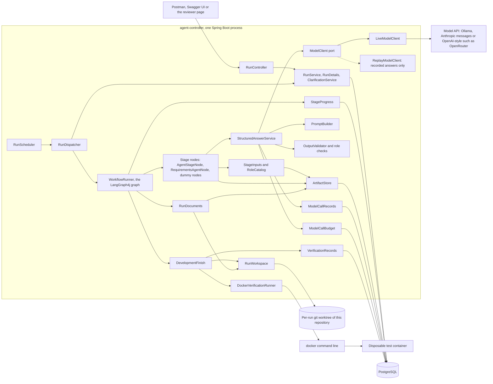
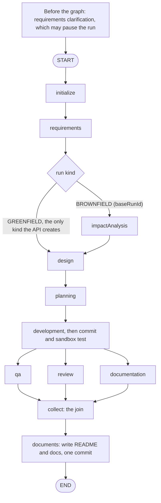
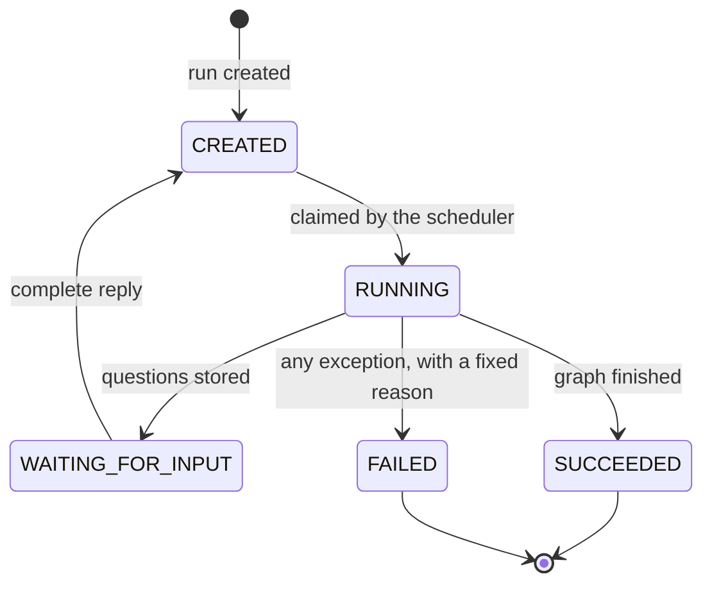
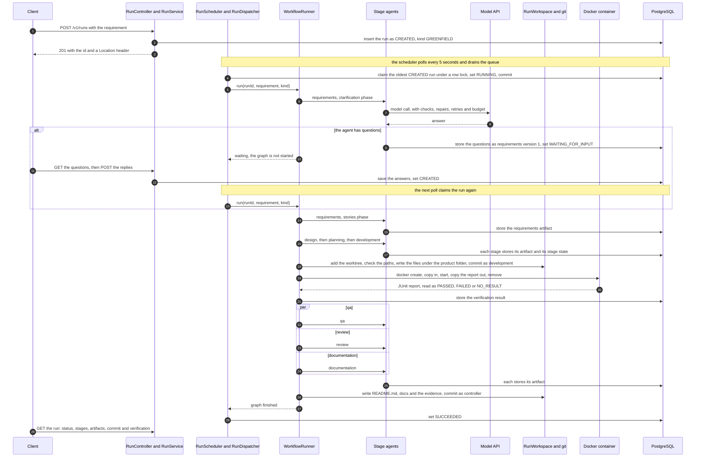

# Architecture overview

This describes the system as built at commit `e6bcaa7` (2026-10-05). It is a thin end-to-end skeleton ([ADR 0004](../adr/0004-build-a-thin-end-to-end-skeleton-first.md)), not the complete governed pipeline in the requirements: the stages run, the generated code is committed, built and tested, and the run ends by the result, but approvals, repair loops and several other controls are not built (section 6). The controller orchestrates; the generated Python service is the product and has no agents inside it.

Sections: 1 Components and packages, 2 Orchestration model, 3 Control flow of one run, 4 Data stored in PostgreSQL, 5 Guardrails that exist, 6 Governance not built yet, 7 Key decisions and their costs.

## 1. Components and packages

One Spring Boot application holds the REST API, the scheduler, the graph, the agents, the model clients, the artifact store, the workspace and the sandbox runner. Only PostgreSQL runs in Docker Compose; the controller runs on the host and starts the `git` and `docker` command lines as processes. An agent is not a service. It is a role definition (`agent-roles/<role>.properties`: identity, standards, the artifact kinds it may read, the fields of its answer), a prompt built by `PromptBuilder`, and the call limits of its run, executed by one generic class.



Packages, all under `io.github.bereket1144.agentcontroller`:

| Package | What it holds |
| --- | --- |
| `run` | The REST API (`RunController`, errors as `application/problem+json`), the run entity and its status, `RunService` (create, claim, succeed, fail), `RunScheduler` and `RunDispatcher`, `RunDetails` (stages, artifacts and verification for reads), `ClarificationService` (questions and replies), and the fixed failure reasons |
| `workflow` | `WorkflowRunner` (the graph), the dummy nodes, `AgentStageNode` (one generic stage for any role), `AgentStages` (which roles run on an agent), `RequirementsAgentNode` (clarification, then stories), `DevelopmentFinish` (commit and verify) and `StageProgress` |
| `agent` | `RoleCatalog`: the eight role definitions, and `InputAccessDeniedException` |
| `model` | The `ModelClient` port; `ModelProfile`, `ModelProperties` and `ModelProfiles`; `PromptBuilder`; `OutputValidator` and the role checks; `StructuredAnswerService`; `ModelCallBudget`; `LiveModelClient`, which sends a call to `OllamaModelClient`, `HostedModelClient` (Anthropic messages API) or `OpenAiCompatibleModelClient` by the profile's API style |
| `modelcall` | `ModelCallRecords` (one row per attempt), `InputFingerprint`, `Recording` and `ReplayModelClient` |
| `artifact` | `ArtifactStore` (immutable, versioned outputs), `ArtifactRef` and `StageInputs` (what a role may read) |
| `workspace` | `RunWorkspace` (`git worktree add` on `run/<run-id>`, sparse checkout, write, commit), `ChangeSet` and `ChangeSetCheck` (path and size rules), `WorkspaceMerge` (conflict preflight and merging completed work into a clean checkout) |
| `sandbox` | The `VerificationRunner` port, `DockerVerificationRunner`, the `DockerCommand` port, `JunitReportParser`, the verification result and its records, `SandboxProperties` |
| `document` | `MarkdownRenderer` and `RunDocuments` (the README and `docs/` written from artifacts) |
| `checkpoint` | `CheckpointSaverFactory` for the LangGraph4j PostgreSQL saver. Only tests use it; the running graph has no saver |
| `static/` resource folder | The reviewer page at `/`: plain HTML, CSS and JavaScript that call the same HTTP operations |

Settings that choose behaviour:

| Setting | Effect |
| --- | --- |
| `agent.stages.<role>` | `dummy` (the default: a deterministic marker node, no model) or `agent`. Setting `development` to `agent` also switches on the workspace, the commit-and-verify step and the document export; those three beans exist only then. `application-live.properties` sets every stage except `impactAnalysis` to `agent` |
| `agent.models.profiles.<name>.*`, `agent.models.primary`, `.fallback`, `.roles.<role>` | The model profiles (model, address, window, answer limit, timeout, call slots, retries, key, `api-style`, `reasoning`), the default profile, an optional fallback and a profile per role |
| `agent.model-client.mode` | `live` (the default) or `replay` with a recording file |
| `agent.budget.*`, `agent.output.repair-limit`, `agent.models.retry-delay` | The call and token limits, the repair limit and the first retry wait |
| `workspace.base` | The folder that holds one worktree per run, outside the checkout; required when development is on an agent |
| `workspace.repository` | The root of this repository, which the worktrees belong to; required when development is on an agent (`..` in the live profile) |
| `workspace.auto-merge` | Merge completed work into the currently checked-out branch before success; false by default, true in the live profile |
| `workspace.base-ref` | The commit that a run's branch is cut from; default `HEAD` |
| `workspace.product-folder` | The product folder, relative to the repository root (`apps/url-shortener`): the agents' files are written there and the sandbox is given only this folder |
| `sandbox.verify.*` | The image, the test command, the report path and the container limits |
| `run.dispatch.*` | Whether the scheduler runs and how long it waits between polls |

## 2. Orchestration model

### One fixed graph

`WorkflowRunner` builds one LangGraph4j `StateGraph` when the controller starts and compiles it once. The topology does not change at run time.



Each stage node is the role's agent when its setting says so, and its dummy node otherwise. An agent stage (`AgentStageNode`) reads only the artifacts its role may read, asks the role through `StructuredAnswerService`, stores one artifact and puts that artifact's `ArtifactRef` (kind, version, fingerprint) in graph state under the role's name. The development node is wrapped by `DevelopmentFinish`. An open question in the answer of a stage other than requirements does not pause the run: it is added to the assumptions as "Unanswered question: ...".

Graph state holds the run id, the requirement text, the run kind, the artifact references, and after development the commit id and the verification outcome name. It is not true that state holds only references: the requirement text travels in it. Stage outputs are in the artifact store, not in state.

### Parallel stages and the join

QA, review and documentation are three edges out of development, so they run side by side. LangGraph4j overlaps them only when the run supplies an executor for the fan-out node, so `WorkflowRunner.run` registers a virtual-thread-per-task executor for `development` (guarded by `ParallelBranchesJoinTest`). `collect` starts only when all three have finished. If one branch throws, the run fails, the other branches are interrupted with `shutdownNow`, and `collect` never runs; that helps only branches that honour interruption. The graph has three fixed branches. A run-time number of parallel development tasks (the scheduler of [ADR 0001](../adr/0001-run-the-task-scheduler-inside-one-node.md)) is not built: development runs once for all stories.

A profile allows one concurrent call by default, so in the live setting the model requests of the three branches are made one after another even though the branches are structurally parallel.

### The clarification pause (outside the graph)

Before the graph starts, `WorkflowRunner.run` asks `RequirementsAgentNode.prepare` to settle clarification ([ADR 0007](../adr/0007-clarify-with-questions-and-answers-only.md)). If the agent has questions, they are stored as requirements version 1, the run becomes `WAITING_FOR_INPUT`, the call returns, and the dispatcher neither succeeds nor fails the run. A complete reply to `POST /v1/runs/{id}/replies` stores the answers and puts the run back to `CREATED`; the next poll claims it again and goes straight to the stories. The wait is rows in PostgreSQL, so it needs no thread and survives a restart.



### Stage progress

`StageProgress` writes a `run_stage` row when a stage starts (`RUNNING`), when it returns (`FINISHED`) and when it fails for good (`FAILED`). A stage that fails for a retryable reason (`OUTPUT_INVALID`, `MODEL_UNAVAILABLE`, `VERIFICATION_FAILED` or an unexpected error) is attempted again, up to `agent.stage.max-retries` more times, and is `RUNNING` again for each attempt; after a failed build the development agent is given the failing tests and the workspace files. A stage with no row is `NOT_STARTED`. While a run waits for answers the requirements stage shows `RUNNING`. `GET /v1/runs/{id}` lists all eight stages in graph order, so `impactAnalysis` reads `NOT_STARTED` on the greenfield route.

### Document export after the join

When development is on an agent the graph has one more node after `collect`. `RunDocuments` writes the README and the documents from the latest version of each artifact kind, by plain code and without a model, in one commit by `controller`. Writing the same versions again changes no file and makes no commit. Because the node sits after the join, a run that failed earlier writes none of the documents.

### What the graph does not do

The graph is compiled without a checkpoint saver. It cannot pause inside itself or resume, and a controller that dies during a run leaves the run `RUNNING`; nothing claims it again. The PostgreSQL saver and its tables exist and are proven by tests, but the live graph does not use them. A controller process runs one run at a time: the scheduler thread dispatches synchronously, and the parallelism is inside a run.

## 3. Control flow of one run



In words:

1. **Accept.** `POST /v1/runs` validates the requirement (not blank, at most 20,000 characters), stores a `CREATED` greenfield run and answers `201` with the id and a `Location` header.
2. **Claim.** `RunScheduler` polls on a fixed delay (5 seconds by default) and drains the queue. `RunService.claimNextRun` selects the oldest `CREATED` run under a pessimistic row lock, sets `RUNNING` and commits before any work starts, so no transaction stays open during model calls.
3. **Clarify.** The requirements agent may ask at most four questions. If it does, the run waits (section 2) and later returns to step 2 with the answers.
4. **Specify and plan.** Requirements (stories), design and planning each read their allowed inputs, call the model, store a versioned artifact and record their stage state.
5. **Develop and verify.** The development agent returns the complete content of every file in one answer. `DevelopmentFinish` makes the run's workspace, a git worktree of this repository on the branch `run/<run-id>` with only the product folder checked out, writes the files under the product folder only after every path passes the checks, and commits them as `development`. `DockerVerificationRunner` copies the product folder (the files, not the repository around them) into a new container, runs the configured test command, copies the JUnit report out and removes the container. The outcome and the test counts are stored with the commit id. Only `PASSED` lets the run go on.
6. **Review in parallel.** QA, review and documentation run side by side and join at `collect`. QA and review are handed the requirements, design and plan and the full development artifact; documentation is handed the requirements, design and plan and an outline of the development artifact with the file contents removed. The three branches start from the same state, so none of them reads another's artifact in this run.
7. **Export.** After the join, `RunDocuments` commits `README.md`, `docs/requirements.md`, `docs/design.md`, `docs/plan.md`, `docs/qa.md`, `docs/review.md` and `docs/diagrams/<n>.mmd` under the product folder, and the evidence under `runs/<run-id>/` (`artifacts/<kind>-v<version>.json` for the latest version of each artifact, and `lineage.json`), in one commit as `controller`.
8. **Finish.** `RunDispatcher` sets `SUCCEEDED`. A client reads the run, then any artifact with `GET /v1/runs/{id}/artifacts/{kind}/{version}`.

The run's branch at the end, `run/<run-id>` of this repository, checked out in `<workspace.base>/<run-id>`. Its commits sit on top of the commit it was cut from (or on the base run's branch, for a change run):

```text
apps/url-shortener/<files the development agent wrote>      commit 1, author development
apps/url-shortener/README.md                                commit 2, author controller
apps/url-shortener/docs/requirements.md, design.md, plan.md, qa.md, review.md
apps/url-shortener/docs/diagrams/1.mmd ...
runs/<run-id>/artifacts/<kind>-v<version>.json, runs/<run-id>/lineage.json
```

With `workspace.auto-merge=true`, `RunDelivery` completes the run after the graph and document export. It locks the run row, checks Stop and the passing verification, then calls `WorkspaceMerge`. Git checks that the checkout is clean, that the run changes only product or evidence paths, and that a merge has no conflicts. It merges the inspected commit into the current branch and `RunService` records success in the same database transaction. A blocked delivery retains the work and records DELIVERY_BLOCKED. The live profile enables automatic delivery; disabling it preserves manual delivery. The controller never switches branches, pushes or deletes the branch. See [ADR 0013](../adr/0013-automatically-merge-completed-work.md).

**Failure path.** Any exception in a stage, in the commit, in the build or in the export is caught by `RunDispatcher`. It records `FAILED` in its own transaction with a fixed reason chosen from the cause chain (`OUTPUT_INVALID`, `MODEL_UNAVAILABLE`, `CONTEXT_TOO_LARGE`, `BUDGET_EXHAUSTED`, `ACCESS_DENIED`, `VERIFICATION_FAILED`, otherwise `UNEXPECTED`), then rethrows the original exception. The API shows the fixed code and message and never the exception text. A verification that is not `PASSED` ends the run with `VERIFICATION_FAILED` before QA, review and documentation start, so no documents are written; the failed stage stays `RUNNING`, and the workspace with the first commit stays on disk.

## 4. Data stored in PostgreSQL

Flyway owns the schema (migrations `V1` to `V12`); Hibernate only validates it.

| Table | What it holds |
| --- | --- |
| `runs` | The requirement, the kind (`GREENFIELD` or `BROWNFIELD`), the status (`CREATED`, `RUNNING`, `WAITING_FOR_INPUT`, `SUCCEEDED`, `FAILED`), the failure reason (set only when `FAILED`, checked by constraints against a fixed list), created and updated times, and a version for optimistic locking. An index on status and creation time serves the claim |
| `artifact` | One row per stage output version, only ever added: kind, version, the validated content as JSON text, a counts-only summary, the SHA-256 fingerprint of that text, the producing role and its version, the profile and model, and the list of input versions it consumed. Unique per run, kind and version |
| `model_call` | One row per model attempt (first, repair, retry or fallback): role, profile, model, attempt kind, input fingerprint, the system text, the user text, the answer text, finish reason, estimated and reported token counts, prompt reduction steps, duration and outcome. Only ever added |
| `model_budget_reservation` | A row for each attempt that has started and whose call record is not yet committed. The budget check counts it; it is removed once the record is committed |
| `verification_result` | One row per build and test: commit id, outcome, tests run, passed and failed, failing test names and a bounded excerpt of the report |
| `run_stage` | The state of each stage of a run: `RUNNING` or `FINISHED` |
| `clarification_batch` | One row per question batch of a run: the artifact version that holds the questions, the answers as JSON text and the time they were given |
| `LG4JThread`, `LG4JCheckpoint` | The tables of the LangGraph4j PostgreSQL saver, created by migration `V5`. The running graph has no saver, so a normal run leaves them empty; tests that prove pause and restart use them |

Not in the database: the generated product and the documents (they are on the run's branch `run/<run-id>`), the JUnit report copied out of the container (a temporary folder, deleted after reading) and the logs. The stored model calls hold full prompts and answers, so the database may contain the requirement and generated content.

## 5. Guardrails that exist

| Guardrail | Where | What it does |
| --- | --- | --- |
| Path and size checks on generated files | `ChangeSetCheck`, `ChangeSet`, `RunWorkspace` | The development answer must list at least one file. Each path must be relative, free of `..` and not under `.git` (compared without regard to case), and each file at most 100,000 bytes. A violation is a check message and goes into the repair loop. `RunWorkspace` applies the path rule again, refuses to write through a symbolic link, writes nothing unless every file is allowed, and adds files with literal path specs. Agents never write files; the controller does |
| Sandbox | `DockerVerificationRunner`, `SandboxProperties` | A new container per verification: non-root user `10001`, `--network none`, memory and swap 1g, 1 CPU, 256 processes, a time limit of 5 minutes by default, no host folder mounted, no environment passed, a platform label, removed afterwards. Workspace copied in, one report copied out ([ADR 0005](../adr/0005-run-builds-and-tests-in-one-disposable-container.md)) |
| Plain-code verdict | `JunitReportParser`, `DevelopmentFinish` | Pass or fail comes from the parsed test report, never from a model and never from the container's exit code. No readable report in time is `NO_RESULT`, which fails the run with `VERIFICATION_FAILED` |
| Call budget | `ModelCallBudget` | Before every attempt (including repairs, retries and fallbacks) a reservation is made under a lock on the run. The limits are calls per run (100), calls per role (20) and estimated tokens per run (200,000 by default; 1,000,000 in the live settings). Beyond a limit the run fails with `BUDGET_EXHAUSTED`, before the call |
| Retries and fallback | `StructuredAnswerService` | A timeout, an unreachable server, a rate limit or a server error is retried on the same profile (2 retries by default) with doubling waits from 200 ms, capped at 30 s. When retries are used up and the failing profile is the primary, one call goes to the fallback profile if one is configured, with the prompt sized for its window. Otherwise, and for a rejected or unreadable response, the run fails with `MODEL_UNAVAILABLE`. The shipped settings name no fallback |
| Output validation and repair | `OutputValidator`, role checks, `StructuredAnswerService` | One JSON object is taken from the answer (a code fence or prose around it is tolerated; none, several, malformed or incomplete are rejected) and checked against the role's declared fields. Missing, blank and wrongly typed fields are named, and undeclared fields are dropped. Role checks cover the requirements stories and criteria and the development change set. An invalid answer, or one cut off at the answer limit, is repaired with the previous answer and the exact messages, up to 2 repairs by default, then the run fails with `OUTPUT_INVALID`. A cut-off repair asks for a much shorter answer |
| Context window | `PromptBuilder` | The prompt plus the answer limit plus a safety margin (10% of the window) must fit the profile's window. Optional context is shortened first, then the least important inputs in the order the role lists them. The task, the original requirement and the answers are never shortened. If it still does not fit, the run fails with `CONTEXT_TOO_LARGE` before any call |
| Role input limits | `StageInputs`, `PromptBuilder` | A role is handed only artifact kinds its definition lists. Anything else fails with `ACCESS_DENIED` before an artifact is read or a model is called |
| Safe claiming | `RunService.claimNextRun`, `RunRepository` | The claim takes a row lock and commits `RUNNING` before work starts, so two dispatchers cannot take the same run |
| Request and error handling | `RunRequest`, `ApiExceptionHandler` | A requirement must not be blank and is limited to 20,000 characters. Errors use one `application/problem+json` shape with fixed texts; a non-UUID id is `400` and an unknown run or artifact is `404` |
| Secrets and logs | model clients, `ModelProfile` | A model key is read from the environment, sent as a header and left out of `ModelProfile.toString`. The sandbox gets no environment. Log lines carry ids, kinds, counts and outcomes, never the requirement, a prompt, an answer or a key |
| Replay | `ReplayModelClient` | With `agent.model-client.mode=replay` model answers come from a recording; a call the recording does not hold fails with `REPLAY_MISSING`. Only model answers are replayed: files are written, builds and tests run for real |

## 6. Governance not built yet

The controls below are required by the project but are not in the code. Do not read `SUCCEEDED` as approved, reviewed or release-ready: it means the stages returned and the generated tests passed.

- **Plain-code gates.** The only gate is the verification outcome. There is no entry or exit gate on a stage, no check of the QA or review content, no criterion-to-test coverage check, no coverage threshold for the product and no release-readiness gate. QA and review artifacts are model-written, stored and shown; their findings change nothing (AGT-30, AGT-31).
- **Fix loops.** A failed build or test fails the run. Nothing sends the findings back to development. The only repair loop is for the shape of a model answer.
- **Approvals.** The role definitions mark which outputs would need approval and the prompt says so, but nothing enforces it. There is no approval operation and no authenticated approver; no merge approval (AGT-13 to AGT-15, AGT-32). The one human step is the reply to the requirements questions.
- **Rollback and discard.** AGT-43 implements cooperative stop/resume: a durable database flag is checked at model, stage and build boundaries, an active build is cancelled, and STOPPED keeps artifacts and the workspace. Resume rebuilds state through the existing first-retry mechanism or restores a pending human wait. Test execution is pending. It does not delete the workspace, undo commits or recover a crashed controller; those are separate controls. A change set is written file by file before the commit, so a failure in between leaves files in the workspace.
- **Audit trail.** There is no append-only event trail (AGT-44). The records that exist are the run's status, the model calls, the artifacts with their consumed versions, the verification results, the stage states, the commits and the log lines.
- **Re-planning.** A changed requirement cannot be applied to a run that is going, and a stale result is not refused. Each run goes through the graph once.
- **Brownfield, partly.** `POST /v1/runs` takes `kind` and `baseRunId`; the run's branch is cut from the base run's branch `run/<baseRunId>`, and the impact analysis, design, planning and development agents are shown the existing files of the product folder (bounded in size). Impact analysis is not checked against the real files by plain code, and the base run's branch must still exist.

Also not built:

- **Per-task development.** The planned tasks do not become scheduled units of work. Development writes all files in one answer, so the requirement has to stay small.
- **Crash recovery and resume.** Runs stranded in `RUNNING` are not failed or resumed at startup, and leftover containers are not removed (AGT-39). The live graph has no checkpoint.
- **Metrics and lineage reads.** There is no report of success rate, retries or latency (AGT-46). The consumed versions of each artifact are stored, but no operation returns them (AGT-47).
- **Access control.** The API is unauthenticated. Use it only in a trusted local environment.
- **Stage time limits.** Only the per-call timeout of a model profile and the time limit of the container exist.

See [limitations and trade-offs](limitations.md) for the consequences and [testing](testing.md) for the evidence.

## 7. Key decisions and their costs

| Decision | Record | Cost accepted |
| --- | --- | --- |
| Run the runtime task scheduler inside one graph node | [ADR 0001](../adr/0001-run-the-task-scheduler-inside-one-node.md) | The tasks are not graph nodes and get no checkpoint of their own. The scheduler is planned, not built |
| Call models behind one provider-neutral port | [ADR 0002](../adr/0002-call-local-ollama-behind-the-model-port.md), [ADR 0009](../adr/0009-choose-the-model-api-style-by-profile-setting.md) | One mapping class per API style. `reasoning` is an OpenRouter convention |
| Clarify before writing stories, with questions and answers only | [ADR 0003](../adr/0003-clarify-requirements-before-generating-stories.md), [ADR 0007](../adr/0007-clarify-with-questions-and-answers-only.md) | The assumptions in the stories are confirmed by nobody. The pause is outside the graph |
| Thin end-to-end skeleton first, governance after | [ADR 0004](../adr/0004-build-a-thin-end-to-end-skeleton-first.md) | Section 6 is the price |
| One disposable container per build, started with the docker command line | [ADR 0005](../adr/0005-run-builds-and-tests-in-one-disposable-container.md) | The controller holds Docker daemon access, and containers share the host kernel |
| A git worktree of this repository per run, on the branch `run/<run-id>`, cut from the base run's branch for a change | [ADR 0010](../adr/0010-work-in-a-git-worktree-of-this-repository.md), which supersedes [ADR 0006](../adr/0006-give-each-run-its-own-git-repository.md) | The run's branches and worktree entries live in this repository's `.git`; the controller removes none of them |
| Light tests, coverage gate at 85% for now | [ADR 0008](../adr/0008-keep-tests-light-and-gate-coverage-at-85-percent-for-now.md) | Coverage is below the 100% target until a sweep |

Decisions without a record of their own:

- One local Spring Boot controller keeps orchestration, transactions and debugging in one process. Distributed execution is not claimed.
- Python with the standard library, SQLite and pytest, in a prebuilt image, keeps the first product execution offline and small. Java is the controller's language; there is no Java product profile.
- Agents return whole files. That is easy for a model to produce and for the controller to check, but a multi-file write is not transactional.
- Artifacts are versioned and passed on by reference, which keeps provenance without putting full outputs in graph updates.
- There is no RAG, vector store or MCP in the execution path; context is injected directly into the prompt.
