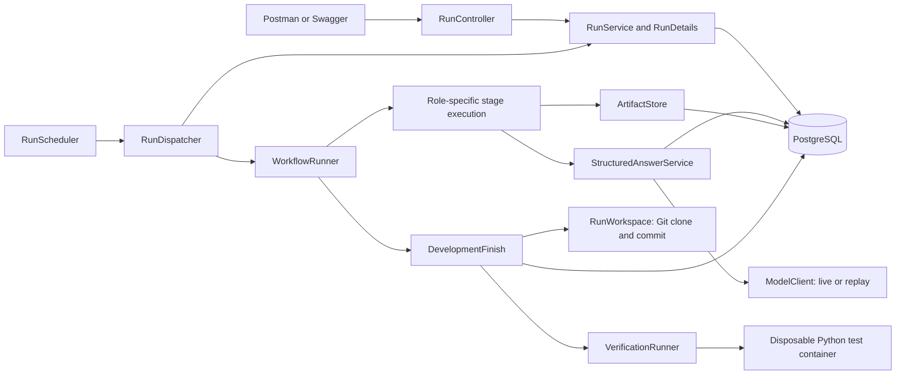
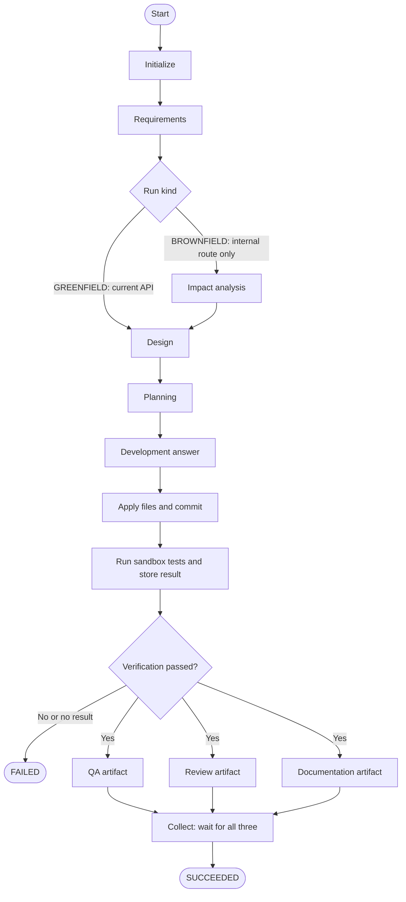

# Architecture overview

This describes the implemented end-to-end skeleton at baseline `91be0a3`, not the complete pipeline planned in the requirements. The controller orchestrates; the generated Python service is the product and has no agents inside it.

## Components

The REST layer accepts and reads runs. Services own transitions and persisted details; repositories handle storage. The scheduler polls created runs, and the service claims one with a transaction and database locking. The claim commits before execution, so the graph does not hold the claim transaction open during model calls.

`WorkflowRunner` compiles the graph once. `RequirementsAgentNode` and generic `AgentStageNode` execute roles selected by configuration; other stages keep their deterministic dummy nodes. Role resources define identity, expected structured output and allowed inputs. `StageInputs` resolves only the artifacts that a role may consume.

`StructuredAnswerService` builds prompts, validates answers, bounds repairs and transient retries, supports configured fallback, and records model attempts. A budget reservation is made before each model call. Live clients and replay implement the same model port. Replay substitutes model answers only.

`ArtifactStore` stores immutable, versioned outputs with fingerprints and input lineage. Agent outputs pass through graph state as artifact references. The current invocation also carries the run id, requirement text and run kind; it is not accurate to claim that all graph state contains references only. Stage progress and verification results are stored separately for API reads.

## Implemented execution flow

The three graph branches run concurrently using a per-run virtual-thread executor. The model profile's call concurrency limit can serialize their actual model requests. Structural parallelism does not promise simultaneous API calls.

Development currently runs once for the entire plan. Its validated whole-file change set is applied by the controller, committed and tested before QA, review and documentation begin. Their outputs are stored, but their findings do not yet trigger repairs or block success. Any stage exception fails the dispatch; verification must produce a passing report to proceed.

## Execution and data boundaries

Each run gets a separate Git clone outside the controller checkout. Only the product and runs directories are checked out, although Git retains the repository history. Writes are limited to the product folder and that run's own folder. Agents return file contents and cannot directly write files or invoke Docker.

The controller uses the Docker CLI through `DockerCommand`. It copies the workspace into a new container, runs as UID/GID `10001`, disables networking, sets CPU, memory, process and time limits, copies out the JUnit report, then removes the container. No host directory is mounted. Plain code parses the report and records the outcome with the commit id.

PostgreSQL stores runs, model calls and reservations, artifacts, stage progress and verification results. Flyway owns schemas and Hibernate validates them. A separate `PostgresSaver` factory and foundation tests prove JSON checkpoint storage and pause/resume mechanics. The live `WorkflowRunner` currently compiles without a checkpoint saver; it does not offer durable human pauses or graph resume.

## Decisions and their costs

- One local Spring Boot controller keeps orchestration, transaction boundaries and debugging in one process. Distributed execution is not claimed.
- Python standard-library code with SQLite and a prebuilt pytest image keeps the first product execution offline and small. Java remains the controller language; no Java product execution profile is supplied.
- Whole-file writes are easier for models to produce and for the controller to validate. They do not provide transactional rollback across multiple file writes.
- Versioned artifacts preserve provenance without putting full outputs in graph updates. Export, approvals and stale-result rejection remain later work.
- Direct HTTP model clients hide provider differences behind `ModelClient`. There is no RAG or MCP dependency in the execution path.

See [ADR 0001](../adr/0001-run-the-task-scheduler-inside-one-node.md) for the intended runtime task scheduler inside one node. The current fixed graph has no per-task development scheduler yet. [ADR 0002](../adr/0002-call-local-ollama-behind-the-model-port.md) records the local model port decision; OpenAI-compatible hosted calls extend that port.
